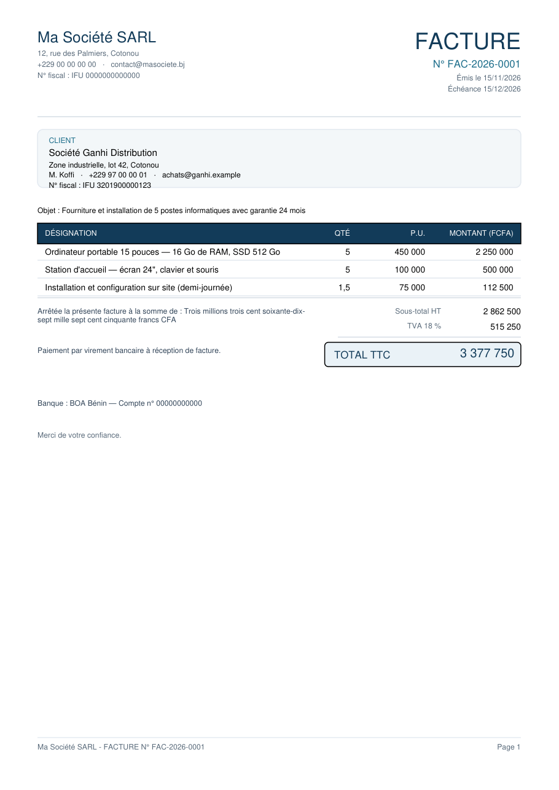

# Dev-Fact — Gestion des devis et des factures

Application web **100 % Java** (Jakarta EE 10) pour établir, suivre et imprimer des **devis** et des
**factures** : clients, lignes détaillées, TVA, numérotation automatique, conversion devis → facture,
export PDF via JasperReports, authentification **JAAS** sur une base **PostgreSQL**.



---

## 1. Fonctionnalités

| Domaine | Détail |
|---|---|
| **Devis & factures** | Création, modification (brouillon), duplication par conversion, suppression des brouillons |
| **Lignes de document** | Désignation, quantité décimale, prix unitaire, montant calculé côté serveur |
| **Calculs** | Sous-total HT, TVA paramétrable (18 % par défaut), total TTC, montant en lettres (« Arrêtée la présente facture à la somme de… ») |
| **Numérotation** | Automatique et atomique : `DEV-2026-0001`, `FAC-2026-0001` (préfixes et compteurs par année) |
| **Cycle de vie** | Devis : brouillon → envoyé → accepté / refusé → facturé. Facture : brouillon → émise → payée / annulée |
| **Conversion** | Un devis envoyé ou accepté devient une facture brouillon (lignes et montants recopiés, double conversion bloquée) |
| **Clients** | Fiche complète (raison sociale, contact, adresse, IFU/NIF), activation/désactivation, recherche |
| **PDF** | JasperReports : en-tête société, bloc client, tableau des lignes, totaux, mentions bancaires, pagination |
| **Recherche** | Filtres par statut, client, numéro, objet ; pagination |
| **Sécurité** | JAAS (LoginModule maison + PostgreSQL), mots de passe PBKDF2-SHA256, sessions, jetons CSRF, rôles `ADMIN` / `COMMERCIAL` |
| **Paramètres** | Coordonnées société, devise, taux de TVA, préfixes, délais de paiement et de validité |
| **Interface** | JSP + JSTL, feuille de style maison (aucun CDN), responsive, styles d'impression |

---

## 2. Stack technique

| Couche | Technologie |
|---|---|
| Langage | Java 17 |
| Serveur d'application | **WildFly 35** (Jakarta EE 10, `jakarta.*`) |
| Vues | **JSP 3.1** + **JSTL 3.0** + EL |
| Contrôleurs | **Servlets 6.0** (annotations `@WebServlet`, `@WebFilter`, `@WebListener`) |
| Sécurité | **JAAS** (`javax.security.auth.spi.LoginModule`) + PBKDF2 |
| Persistance | **PostgreSQL 16** via **JDBC** (DAO + `PreparedStatement`), sans ORM |
| Documents | **JasperReports 6.20.6** → PDF |
| Build | Maven (packaging `war`) |
| Déploiement | Docker Compose (PostgreSQL + WildFly) ou serveur existant |

---

## 3. Démarrage rapide (Docker)

```bash
cp .env.example .env          # mot de passe de la base (facultatif)
docker compose up --build     # construit le WAR, démarre PostgreSQL puis WildFly
```

Puis ouvrir **http://localhost:8080/dev-fact/**

| Identifiant | Mot de passe | Rôle |
|---|---|---|
| `admin` | `Admin@2026` | Administrateur (accès aux paramètres) |
| `commercial` | `Demo@2026` | Commercial |

> Au premier démarrage, PostgreSQL exécute `database/01_schema.sql` puis `database/02_seed.sql`.
> Pour disposer d'exemples, exécutez ensuite `database/optional/03_demo_data.sql` (voir
> [docs/DEPLOIEMENT.md](docs/DEPLOIEMENT.md#jeu-de-données-de-démonstration)).
> **Changez les mots de passe par défaut avant toute mise en production** (section 6).

---

## 4. Déploiement sur un WildFly existant

```bash
# 1. Base de données
createdb devfact
psql -d devfact -f database/01_schema.sql
psql -d devfact -f database/02_seed.sql

# 2. Application
mvn clean package                                  # produit target/dev-fact.war
cp target/dev-fact.war $WILDFLY_HOME/standalone/deployments/

# 3. Connexion à la base (variables d'environnement du serveur, dans standalone.conf)
DEV_FACT_DB_URL=jdbc:postgresql://localhost:5432/devfact
DEV_FACT_DB_USER=devfact
DEV_FACT_DB_PASSWORD=devfact
```

Accès : **http://localhost:8080/dev-fact/** — guide détaillé, source de données JNDI et dépannage :
[docs/DEPLOIEMENT.md](docs/DEPLOIEMENT.md).

---

## 5. Configuration

L'application résout sa configuration dans cet ordre : propriété système (`-Ddevfact.db.url=…`),
puis variable d'environnement, puis valeur par défaut.

| Variable | Propriété système | Valeur par défaut | Rôle |
|---|---|---|---|
| `DEV_FACT_DB_URL` | `devfact.db.url` | `jdbc:postgresql://localhost:5432/devfact` | URL JDBC (utilisée si le JNDI est absent) |
| `DEV_FACT_DB_USER` | `devfact.db.user` | `devfact` | Utilisateur PostgreSQL |
| `DEV_FACT_DB_PASSWORD` | `devfact.db.password` | `devfact` | Mot de passe PostgreSQL |
| `DEV_FACT_DS` | `devfact.ds` | `java:jboss/datasources/DevFactDS` | Nom JNDI prioritaire |

Si la source de données JNDI existe dans WildFly, elle est utilisée en priorité (pool géré par le
serveur) ; sinon l'application se connecte directement avec le pilote embarqué : le déploiement
fonctionne dans les deux cas.

Les paramètres métier (société, devise, TVA, préfixes, délais) se modifient dans l'écran
**Paramètres** (réservé au rôle `ADMIN`).

---

## 6. Gestion des comptes

Les mots de passe sont stockés hachés (PBKDF2-HMAC-SHA256, 120 000 itérations, sel de 16 octets),
au format `pbkdf2-sha256$itérations$sel$empreinte`.

```bash
# Générer une empreinte à insérer manuellement en base
java -cp dev-fact.war com.devfact.security.PasswordTool "MonNouveauMotDePasse"

# Ou créer directement un utilisateur
java -cp dev-fact.war com.devfact.security.PasswordTool --create \
     jdupont "MonNouveauMotDePasse" ADMIN "Jean Dupont" jdupont@example.com
```

La commande lit la configuration de connexion dans les mêmes variables d'environnement que
l'application.

Sécurité applicative :

- authentification par **JAAS** : `LoginContext` → `DevFactLoginModule` → vérification en base ;
- session HTTP `HttpOnly`, expiration après 30 minutes, renouvellement de session à la connexion ;
- jeton **CSRF** obligatoire sur toutes les requêtes `POST` ;
- contrôle d'accès centralisé dans `AuthFilter` (toute page hors `/login` et `/assets` exige une session) ;
- échappement systématique des données affichées (`<c:out>`) ;
- requêtes SQL paramétrées (aucune concaténation de valeurs).

---

## 7. Structure du projet

```
├── database/
│   ├── 01_schema.sql              # tables, contraintes, index, triggers
│   ├── 02_seed.sql                # comptes + paramètres société
│   └── optional/03_demo_data.sql  # jeu d'exemple (facultatif)
├── docker/
│   └── wildfly-datasource.cli     # source de données JNDI (facultatif)
├── docs/
│   ├── ARCHITECTURE.md            # conception, modèle de données, flux
│   └── DEPLOIEMENT.md             # guide de déploiement et dépannage
├── src/main/java/com/devfact/
│   ├── config/                    # lecture de la configuration
│   ├── db/                        # DataAccess, transactions, DataSource
│   ├── dao/                       # accès JDBC (clients, documents, utilisateurs, séquences)
│   ├── model/                     # entités, énumérations (types, statuts, rôles)
│   ├── service/                   # règles métier (numérotation, totaux, conversion)
│   ├── security/                  # LoginModule JAAS, principal, hachage, outil CLI
│   ├── report/                    # rendu JasperReports
│   ├── web/                       # servlets, filtres, listener, aides de formulaire
│   └── util/                      # montants, dates, montant en lettres
├── src/main/resources/reports/   # document.jrxml (source) + document.jasper (précompilé)
├── src/main/webapp/
│   ├── assets/css/app.css
│   ├── WEB-INF/views/             # JSP (login, listes, formulaires, fiche, paramètres)
│   └── WEB-INF/{web.xml,jboss-deployment-structure.xml}
├── Dockerfile
├── docker-compose.yml
├── .env.example
└── pom.xml
```

## 8. Personnaliser le modèle PDF

Le rendu provient de `src/main/resources/reports/document.jrxml` (A4, Helvetica, montants
pré-formatés). L'application charge le modèle **précompilé** `document.jasper` livré dans le WAR ;
après toute modification du `.jrxml`, régénérez-le :

```bash
mvn -q dependency:build-classpath -Dmdep.outputFile=target/cp.txt
java -cp "target/classes:$(cat target/cp.txt)" com.devfact.report.TemplateCompiler
mvn clean package
```

Si le `.jasper` est absent, l'application compile le `.jrxml` au démarrage (le compilateur ECJ est
embarqué dans le WAR). Le modèle contient les éléments suivants, modifiables sans toucher aux
paramètres : en-tête société, bloc client, tableau des lignes, bloc totaux, mentions bancaires,
pied de page avec pagination.

---

## 9. Vérifications effectuées

- Compilation intégrale des sources (`javac`/ecj, niveau de langage 11 compatible Java 17) : **63 classes**.
- Schéma, données initiales et jeu de démonstration exécutés sur **PostgreSQL 16**.
- **29 requêtes SQL** extraites des DAO puis validées sur la base réelle (exécution en transaction
  annulée ou `PREPARE`), colonnes relues par le code contrôlées une à une.
- Génération PDF testée de bout en bout (JasperReports 6.20.6) : rendu A4 vérifié, accents et
  montants corrects, montant en lettres validé (0 → « zéro », 80 → « quatre-vingts »,
  200 000 → « deux cent mille », 3 245 000 → « trois millions deux cent quarante-cinq mille »).
- Authentification testée au niveau JAAS : hachage du seed accepté, principal ajouté puis retiré,
  échec de connexion propagé avec sa cause.
- 19/19 vérifications de sécurité et de formatage réussies.

---

## 10. Limites de cette version 1

- Périmètre volontairement resserré : **devis, factures, clients, PDF** (pas de catalogue produits,
  pas de tableau de bord, pas d'écran d'administration des utilisateurs — création via `PasswordTool`).
- Pas d'envoi d'e-mail ni de relances automatiques.
- Pas de gestion des règlements partiels ni des avoirs.
- Pas encore de tests automatisés dans le dépôt (JUnit) : les vérifications décrites ci-dessus ont été
  exécutées hors du dépôt pendant le développement.
- Interface en français uniquement.

Pistes d'évolution : catalogue d'articles, avoirs, règlements multiples, export comptable,
envoi par e-mail, tableau de bord (CA, encours), gestion des utilisateurs dans l'interface.

---

## 11. Documentation

- [docs/DEPLOIEMENT.md](docs/DEPLOIEMENT.md) — installation, configuration, sauvegardes, dépannage
- [docs/ARCHITECTURE.md](docs/ARCHITECTURE.md) — conception technique et modèle de données
